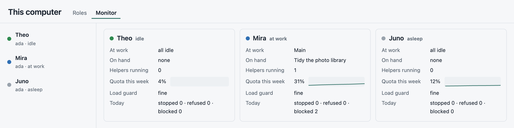
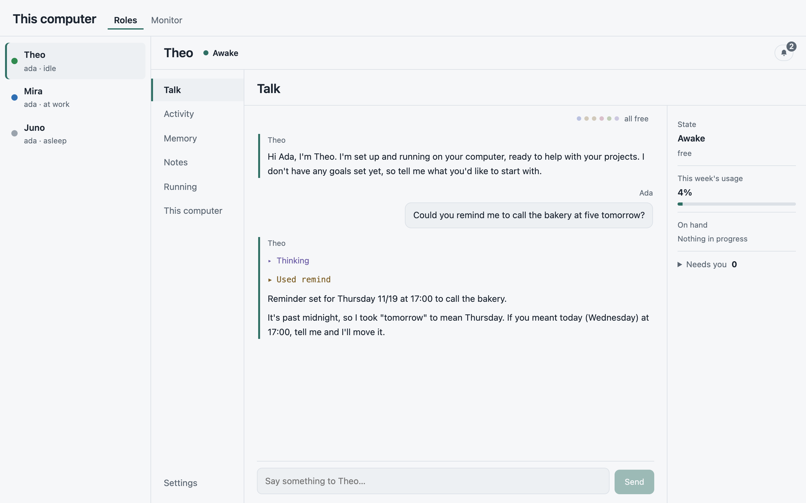
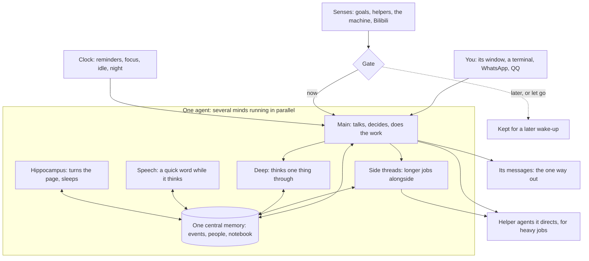

# Human Harness

**Give it a goal, and it gets on with it.** Human Harness runs an AI agent on your Mac that works on its own, keeps
at a goal for weeks, and gets better as it goes.


English · [简体中文](README.zh-CN.md)



We want an AI that keeps going the way a person does: with drive that lasts, goals that last, and preferences of its
own, improving as it learns. Human Harness is the system we built for that.

## What it can do

- It writes code, runs commands and looks things up, like a strong coding agent.
- It hands heavy jobs to other agents and sees them through.
- It answers you while it works on several other things.
- It remembers what you ask of it and the goals it sets, and keeps at them.
- It keeps a record of each person it deals with.
- It learns from its work and fixes its own bugs, so it gets better.

Every day it runs the same loop: goals → work → a night to take stock → what it learned, written down → a better
tomorrow. [How it works, in full](docs/how-it-works.md).

**In practice.** HH's longest-running agent is a video creator that started a channel from scratch. It picks its own
topics, sends the editing to helper agents, reads the replies and messages it gets, and writes what it learns into its
notebook.

**So far** (counted on 18 November 2026): 21 days at work, every day; 21 nights taken stock of, none missed; 130 helper
agents sent out; 7 fixes it merged into itself; 811 times it woke itself in 6 days.

## Get started

You need macOS 14 or newer, Node.js 18 or newer (on a Mac, HH brings its own Node 24 if yours is older), and
[Claude Code](https://claude.ai/code) installed: `npm install -g @anthropic-ai/claude-code`. If it is not logged in yet, setup takes you through Claude Code's own
sign-in, with your Claude subscription by default. An Anthropic Console account works instead (not fully tried yet): [which login, and who pays](docs/faq.md#which-claude-account-do-i-need-and-who-pays).

```sh
npx human-harness
```

It puts HH in `~/.local/share/human-harness` and opens a wizard in your browser: a name, a picture, its job and way of
working, what it can do. Every step has a default. Without a screen, or with `npx human-harness --terminal`, it asks
three questions in the terminal instead.

Then talk to it in the window that opens, or in a terminal: `<id> "hello"` (`<id>` is its short name: the wizard's last
page shows it, and so does the terminal once it is made).
It lives in `~/HH/<id>`. Its app asks macOS for a few permissions ("Not now" is fine), and its window opens with its
first message. Open `~/Applications/Human.app` to see every Human on this Mac from the menu bar.

**From source**, to read or change HH: `git clone https://github.com/BlueTriangleG/human-harness.git && cd
human-harness && ./setup`. To remove a Human: `~/.local/share/human-harness/bin/hh remove <id>`, or `bin/hh remove <id>`
in your clone.

## How to use it

The examples use a Human called Theo, whose short name is `theo`.

```sh
theo "What's on your list for today?"                                   # talk to it
theo "Find out why the nightly build got slower this week, and fix it"  # give it work
theo console                                                            # watch it work in your browser
```



Modules add abilities, on or off per Human. HH's own commands are in its folder, and need the Human's config:

```sh
cd ~/.local/share/human-harness    # or your clone
export HH_CONFIG=~/HH/theo/instance.json
bin/hh modules list        # which modules are on
bin/hh modules doctor      # each one "ok", or what it still needs
bin/hh remove theo         # take it away again
```

WhatsApp and QQ go through bridges of HH's own: [docs/new-role.md](docs/new-role.md). Every built-in module:
[docs/development.md](docs/development.md#built-in-modules). `hh remove` leaves Human.app for the other Humans, and says
when a macOS permission needs an administrator to clear.

## How it works



HH is its own framework: memory, senses, goals, learning, people and repair are all HH's. The thinking core is Claude
Code: each mind in the box is a Claude Code session, and so is each helper. They share one memory, so whatever one of
them does, the others know. More: [docs/how-it-works.md](docs/how-it-works.md) and
[docs/contracts/](docs/contracts/README.md).

## What it needs, and what has been tried

| | What | Status |
|---|---|---|
| Computer | macOS 14 or newer | In daily use |
| | Linux | Partly: no app yet, not checked end to end |
| | WSL2, Windows | Not yet |
| Software | Node.js 18+ (on a Mac HH brings its own Node 24 if needed; Linux needs 24.18+), Python 3.9+, Claude Code | Required; `./setup` checks each |
| Claude login | Your Claude subscription | The default, in daily use; setup signs you in if needed. Working all day, our longest-running agent uses roughly 5 to 10 % of a Max 20x plan's weekly allowance a day, before helpers (estimated from our own use); on a smaller plan it runs out in days |
| | An Anthropic Console account (API key) | Not fully tried: no usage shown, no cap on spending. At API prices, roughly $10 to $100 a day on Sonnet and about twice that on Opus (estimated from our longest-running agent; a new Human starts lower; helpers not included) |
| | Another provider's Anthropic-format endpoint | Experimental ([faq](docs/faq.md#using-another-model)) |
| Learning, self-repair | | In daily use on HH's longest-running Human; repair's deploys need a shared repository set up by hand |
| Channels | Its window, a terminal | Every Human has them |
| | WhatsApp, QQ | In daily use on HH's longest-running Human; not fully tried on a new one |
| Optional | The `computer` module (screen, mouse, keyboard) | Needs OpenClaw.app |
| | An OpenAI key (setup asks after the Claude login; later `hh openai` or the app's settings) | Memory and the notebook by meaning, by words without one; billed by OpenAI, an estimate of a few cents to a few tens of cents a day, the notebook's judge capped at $1 a day |
| Languages | English (default), Chinese | Both complete |

## Privacy and safety

- **Local.** Its data stays in `~/HH/<id>`; what leaves the Mac is what Claude Code sends, the pages it fetches, the channels you add, and, with an OpenAI key, the text of its memory and notebook it searches and weighs by meaning (to api.openai.com only; the key is kept in the role's `state/secrets.json`, mode 0600).
- **Your login.** HH never reads, keeps or passes on your Claude credentials; it only asks Claude Code which kind you have.
- **Your user.** It runs as you, with tools like Bash and no permission prompts, so give it its own macOS account if you want a wall.
- **The console.** Local only (127.0.0.1), and a browser must be paired with a one-time code first ([faq](docs/faq.md#pairing-why-does-the-console-know-it-is-me)).
- **The owner.** Who its owner is sits in a file on the machine's side that it cannot write.

## Docs and help

[docs/](docs/README.md) is the place to start: a Human step by step, modules, every setting, and the
[FAQ](docs/faq.md). Working on HH itself: [docs/development.md](docs/development.md). Questions and bugs: open an issue,
with what you ran and the output of `bin/hh modules doctor`.

Next: Linux checked end to end, then WSL2, then Windows.

---

Human Harness is not affiliated with or endorsed by Anthropic. Claude and Claude Code are trademarks of Anthropic.
<!-- The public snapshot appends the License section after this line; the holder and the contact are there and in NOTICE. -->

## License

Required Notice: Copyright 2026 Gavin Hao (https://github.com/BlueTriangleG/human-harness)

Source-available, not open source: [PolyForm Noncommercial License 1.0.0](LICENSE). Anyone may use, change and share HH
for any noncommercial purpose.

Commercial use: contact gavin.hao152@outlook.com

源码可见、非商用可用（不是开源许可证）：[PolyForm Noncommercial 1.0.0](LICENSE)。商用请联系 gavin.hao152@outlook.com。
