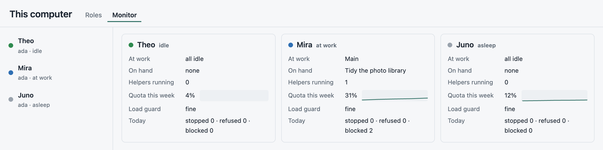
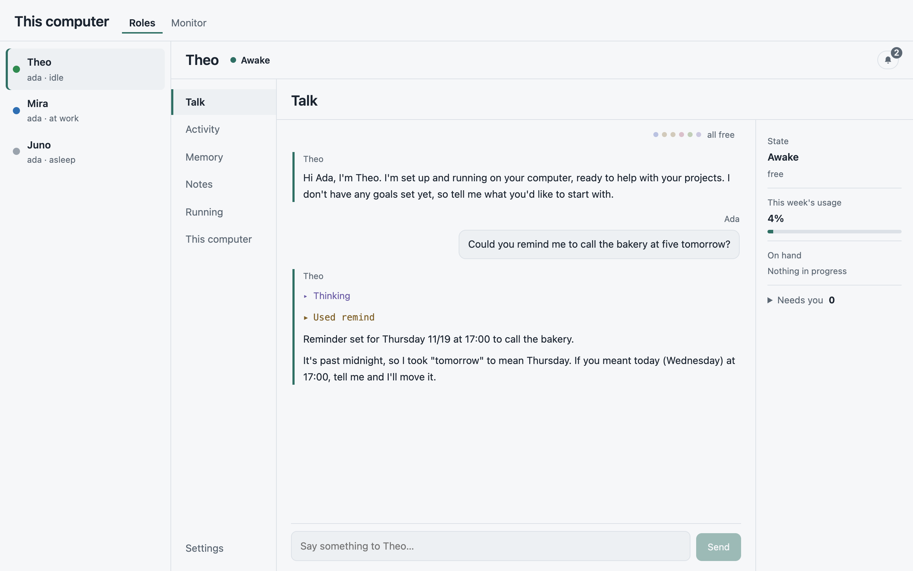
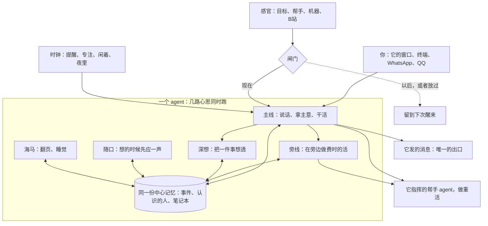

# Human Harness

**给它一个目标，它自己干下去。** Human Harness 在你的 Mac 上跑一个 AI agent：自己干活，一个目标能扛上几周，越做越好。


[English](README.md) · 简体中文



我们想要的 AI，能像人一样：有长久的能动性、长久的目标、自己的偏好，能持续进步，越学越好。Human Harness 就是为这个做的一套系统。

## 它能做什么

- 写代码、跑命令、查资料，像一个强的编程 agent。
- 把重活派给别的 agent，盯着它们做完。
- 一边回你，一边做别的几件事。
- 记得你交代的事和它自己定的目标，一直做下去。
- 跟它打交道的每个人，它都各记一份。
- 从干活里学，自己修自己的毛病，越做越好。

它每天跑同一个循环：目标 → 干活 → 夜里复盘 → 学到的记下来 → 明天更好。[详细的工作方式](docs/how-it-works.zh.md)。

**实际在干的。** HH 跑得最久的那个 agent 是一个从零开始做频道的视频创作者：自己定选题，把剪片子派给帮手 agent，看回复和私信，把学到的记进笔记本。

**到现在**（2026 年 11 月 18 日数的）：连续 21 天天天在干；21 个晚上的复盘一晚没落；自己派出 130 个帮手 agent；自己合进去 7 个修复；6 天里自己醒来 811 次。

## 上手

要 macOS 14 或更新、Node.js 18 或更新（在 Mac 上，你的不够新时 HH 自己带一份 Node 24），装好 [Claude Code](https://claude.ai/code)：`npm install -g @anthropic-ai/claude-code`。还没登录的话，setup 会带你走一遍 Claude Code 自己的登录，默认用你的 Claude 订阅。也可以改用 Anthropic Console 账号（还没完整试过）：[用哪种登录、钱算谁的](docs/faq.zh.md#要哪种-claude-账号钱算谁的)。

```sh
npx human-harness
```

它会把 HH 放到 `~/.local/share/human-harness`，在浏览器里打开一个向导：名字、头像、它的岗位和做事方式、它能做什么，每一步都有默认值。没有屏幕，或者用 `npx human-harness --terminal`，就改成在终端里回答三个问题。

然后在打开的窗口里跟它说话，或者在终端里：`<id> "你好"`（`<id>` 是它的短名：向导最后一页会告诉你，建好时终端里也会说）。它住在 `~/HH/<id>`。它的 app 会向 macOS 要几项权限（点「以后再说」也行），它的窗口会打开，发出第一条消息。打开 `~/Applications/Human.app`，就能从菜单栏看到这台 Mac 上所有的 Human。

**从源码装**，给想看源码、改 HH 的人：`git clone https://github.com/BlueTriangleG/human-harness.git && cd human-harness && ./setup`。卸掉一个 Human：`~/.local/share/human-harness/bin/hh remove <id>`，从源码装的就在 clone 下来的文件夹里跑 `bin/hh remove <id>`。

## 怎么用

下面的例子用一个叫 Theo 的 Human，它的短名是 `theo`。

```sh
theo "今天你打算做什么？"                         # 跟它说话
theo "查一下这周夜里的构建为什么变慢了，把它修好"    # 给它活
theo console                                      # 在浏览器里看它干活
```



模块给它加本事，每个 Human 各自开关。HH 自己的命令在 HH 的文件夹里，要先指到它的配置：

```sh
cd ~/.local/share/human-harness    # 从源码装的就进 clone 下来的文件夹
export HH_CONFIG=~/HH/theo/instance.json
bin/hh modules list        # 哪些模块开着
bin/hh modules doctor      # 每个模块「ok」，或者还差什么
bin/hh remove theo         # 把它卸掉
```

WhatsApp 和 QQ 走 HH 自己的桥：[docs/new-role.zh.md](docs/new-role.zh.md)。自带的每个模块：[docs/development.md](docs/development.md#built-in-modules)（英文）。`hh remove` 会留着 Human.app 给别的 Human 用；要管理员才能清的 macOS 权限，它会照实说。

## 它是怎么工作的



HH 是自己的一套框架：记忆、感官、目标、学习、人物、修理都是 HH 的。负责思考的内核是 Claude Code：框里的每一路心思是一个 Claude Code 会话，每个帮手也是。它们共用一份记忆，一路做过的事，别的几路都知道。更多：[docs/how-it-works.zh.md](docs/how-it-works.zh.md) 和 [docs/contracts/](docs/contracts/README.md)（英文）。

## 要什么、试过什么

| | 是什么 | 情况 |
|---|---|---|
| 电脑 | macOS 14 或更新 | 每天在用 |
| | Linux | 部分能用：还没有 app，没从头到尾核过 |
| | WSL2、Windows | 还不行 |
| 软件 | Node.js 18+（在 Mac 上不够新时 HH 自己带一份 Node 24；Linux 要 24.18+）、Python 3.9+、Claude Code | 必须有；`./setup` 逐样查 |
| Claude 登录 | 你的 Claude 订阅 | 默认，每天在用；没登录时 setup 会带你登录 |
| | Anthropic Console 账号（API key） | 还没完整试过：不显示用量，也不限花费 |
| | 别家提供方的 Anthropic 格式接口 | 实验性（[常见问题](docs/faq.zh.md#换模型)） |
| 学习、自我修复 | | 在 HH 跑得最久的那个 Human 上每天在用；修理的部署要手工搭的共享仓库 |
| 通道 | 它的窗口、终端 | 每个 Human 都有 |
| | WhatsApp、QQ | 在 HH 跑得最久的那个 Human 上每天在用；新 Human 上还没完整试过 |
| 可选 | `computer` 模块（屏幕、鼠标、键盘） | 要装 OpenClaw.app |
| | `state/secrets.json` 里的 OpenAI key | 记忆按意思搜，费用算 OpenAI 的 |
| 语言 | 英文（默认）、中文 | 两种都齐 |

## 隐私和安全

- **在本机。** 数据都在 `~/HH/<id>`；离开这台 Mac 的，只有 Claude Code 本来会发的、它抓取的网页、你自己加的通道，以及加了 OpenAI key 时它按意思搜的文字。
- **你的登录。** HH 从不读、不存、不转交你的 Claude 凭证，只问 Claude Code 登的是哪种。
- **你的用户。** 它以你的身份运行，带着 Bash 这类工具、不弹权限确认；想隔开，就给它单独一个 macOS 账号。
- **控制台。** 只在本机（127.0.0.1），浏览器要先用一次性的配对码配好（[常见问题](docs/faq.zh.md#配对控制台怎么知道是我)）。
- **主人。** 谁是它的主人，写在机器这边一个它自己改不了的文件里。

## 文档和帮助

从 [docs/](docs/README.zh.md) 读起：一步一步建 Human、模块、每一项设置、[常见问题](docs/faq.zh.md)。改 HH 本身：[docs/development.md](docs/development.md)（英文）。问题和 bug：提 issue，写上你跑了什么，附上 `bin/hh modules doctor` 的输出。

接下来：Linux 从头到尾核一遍，再做 WSL2，再做 Windows。

## 许可

源码可见、非商用可用（不是开源许可证），见 [LICENSE](LICENSE) 和 [NOTICE](NOTICE)；商用的联系方式在 NOTICE 里。

---

Human Harness 和 Anthropic 没有隶属或背书关系。Claude 和 Claude Code 是 Anthropic 的商标。
