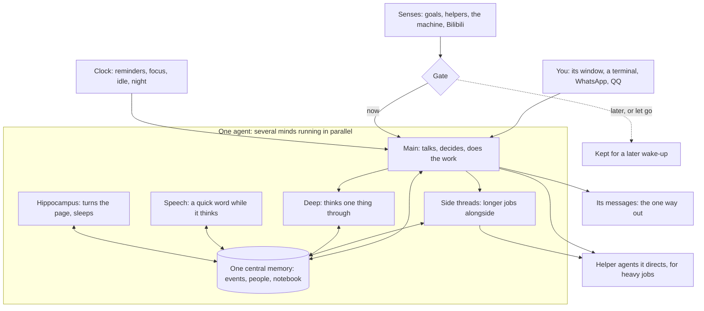

# How Human Harness works

The longer version of the repository's [README](../README.md): what a Human does, the loop that carries a long goal, an example, the full track record, and how the parts fit together. 中文：[how-it-works.zh.md](how-it-works.zh.md).

## What it is

HH is built to take over the work a person does at a computer, and to carry a long goal on its own: plan it, do it,
check it, learn from it, keep going. It is not a chat companion and not a toy. Each agent it runs is called a Human
(inside HH, a role); one Mac can have several.

- **A strong agent.** It does what a strong coding agent does: writes and edits code, runs commands, searches and reads
  the web. And it manages other agents the way a person would: it hands heavy jobs to helper agents, tells them what to
  do, answers their questions and checks what they bring back.
- **Several things at once, one train of thought.** While it answers you, two more of its minds take longer jobs
  alongside and another thinks a hard question through. All of them read and write one central memory, so each job
  keeps its own thread and none of them loses track of the rest.
- **It keeps hold of what you give it.** A job starts with a bar for "done well" and is followed until it gets there,
  set down when it is stuck on someone, and picked up when they answer. What you say to it goes into its memory, which
  it searches by person, by period and by subject.
- **A job and a way of working.** Its persona files say what its job is, how it works and who you are; they go with
  everything it does.
- **It knows who it works with.** In its window and terminal it is talking with you. On WhatsApp and QQ it tells
  people apart, keeps a record of each person and remembers what is between them.
- **It wakes itself.** Its modules hand it events (a goal coming due, a helper finishing, the machine under load); a
  gate decides what needs it now; reminders it set wake it on time (during its night's rest they wait for the morning).
  You do not have to manage any of it.

All of this is one system, built in: the senses, the event memory, the people records and the learning are on in a
new role and work together, with nothing for you to wire up. It comes with its own macOS app and a local console where
you talk to it and watch it work; abilities beyond the core are modules you turn on or off.

### Long goals, carried and improved

What lets it carry a long goal is a loop that runs every day:

1. **Goals at every range.** It keeps its own goals in layers, from long-term to near-term to today's, and sets,
   tracks and closes them itself (the `goals` module).
2. **Time to work on them.** Focus periods through the day, four half-hours by default, are its time to move those
   goals forward (`schedule` in its config).
3. **A night to keep them.** Each night it consolidates what the day did into its memory, so the next day starts
   where this one ended (`src/sleep/`).
4. **Learning that comes back.** What it learned goes into its notebook, a web of linked pages: links from one page to
   another, pages used together on the same job, pages that turn up in the same event. When it starts on something, the
   pages that bear on it come up by themselves, and a mistake it repeats becomes a test the notebook is run against
   every night (`src/learning/`).
5. **Fixing itself.** It keeps a notebook of its own bugs and fixes them, and when you ask for something new it builds
   it with its helpers. Each change is type-checked and fully tested before it goes in, and deployed behind a watchdog
   that rolls back a deploy that fails (`src/repair/`).

Together: it remembers its goals, keeps working toward them, and gets better at the work. The learning and the
self-repair have so far run on HH's longest-running role; repair's deploys need a shared repository set up by hand.

### Example: a video creator, from scratch

HH's longest-running role is set up as a video creator who started a channel from nothing. What HH does in that work:

- It sets its own topics and goals for the channel, and moves them forward in its focus periods (`goals`).
- Heavy work, such as cutting a video, goes to its helper agents (`helpers`); it can watch a video locally (`media`).
- Replies, mentions and private messages on its own Bilibili account reach it as events through the gate
  (`bilibili`).
- What it learns along the way goes into its notebook (`learning`).

### Track record

HH's longest-running role has run on HH since 29 October 2026. Counted from its own tables and logs on 18 November
2026, counts only:

- **Every day, 21 of 21.** 206 restarts (deploys and quiet restarts) and 0.16 hours down in all; the longest gap was
  4.4 minutes, a whole-machine restart. This is read from its logs; there is no separate uptime monitor.
- **21 nights, 21 consolidations completed**, each with its report.
- **554 tasks tracked:** 203 done, 181 waiting on a follow-up, 169 set down, 1 in progress. **238 events** in its
  memory, 47 of them spanning more than a week.
- **130 helper agents** it started itself (since 1 November), which sent back 893 reports, on 123 of its tasks.
- **37 people** it keeps a record of.
- **A notebook of 108 pages and 79 lessons, joined by 356 links.** Since 1 November its association has run 8,150
  times and brought a page up 3,813 times.
- **88 bugs** in its bug notebook and **7 fixes it merged itself.** Of 127 deploys, 6 were its own; the guard turned
  down 9 changes, and the watchdog has not had to roll one back.
- **It wakes itself.** In the 6 days for which the reason is recorded, its main mind woke 1,540 times, 811 of them
  started by itself, and it ran 24 focus periods.

## How it works

HH is its own framework: the memory, the senses, the goals, the learning, the people records and the repair are HH's.
The core that does the thinking is Claude Code: HH is a daemon (`hhd`, a launchd job) that drives the official,
unmodified Claude Code through Anthropic's Agent SDK. Each region (one of the minds in the box) is a Claude Code
session with Claude Code's tools and its own instructions, and the helper agents are Claude Code sessions too. All of them write to and read from one
central memory, so whatever one region does, the others remember. When a session's context fills up, the hippocampus
compresses that page of experience into a block of memory and a fresh page starts. Only the main region (and speech,
in a few words) sends messages, so it speaks with one voice. At night it sleeps: the day is consolidated, its notebook
is checked, and the next day starts from what it kept.

The agreements between the parts are written down in [docs/contracts/](contracts/README.md): the senses, the
night, the channels, the notebook, the modules, and the layout of a role's data. How the code is laid out, its commands
and its rules: [docs/development.md](development.md).
