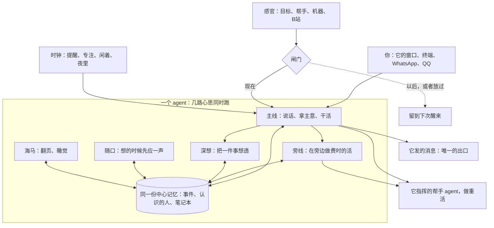

# Human Harness 是怎么工作的

仓库 [README](../README.zh-CN.md) 的长版：一个 Human 能做什么、让它扛住长远目标的那个循环、一个例子、完整的实绩，以及各部分怎么拼在一起。English: [how-it-works.md](how-it-works.md).

## 它是什么

HH 的设计目标是：一个人坐在电脑前能做成的事，都让它接过去；给它一个长远的目标，它能自己扛着做下去——自己定步骤、自己做、自己检查、从中学、接着做。它不是陪聊的，也不是玩具。HH 跑的每一个 agent 叫一个 Human（在 HH 里叫一个角色）；一台 Mac 上可以有好几个。

- **一个强 agent。** 一个强的编程 agent 能做的它都能做：写代码、改代码、跑命令、上网搜、读网页。它还像人一样管别的 agent：重活派给帮手 agent，交代要做什么，回答它们的问题，检查交回来的东西。
- **同时几件事，思路不断。** 它一边回你，另外两路心思在旁边做费时的活，还有一路把一个难题想透。几路都读写同一份中心记忆，所以每件事各有各的线索，谁也不会把别的丢了。
- **交给它的事，它一直盯着。** 一件事开头先定好「做到什么样算做好」，一路跟到做好；卡在等人的时候先放下，那人回话了再接着做。你跟它说的话都进它的记忆，能按人、按时间段、按事情找回来。
- **有岗位，有做事的方式。** 它的人设文件写着它的岗位是什么、怎么做事、你是谁；它做什么都带着。
- **认得跟它共事的人。** 在它的窗口和终端里，跟它说话的就是你；在 WhatsApp、QQ 上，它分得清谁是谁，每个人各有一份记录，记得和每个人之间是怎么回事。
- **自己醒。** 它的模块把事件交给它（目标到点了、帮手做完了、机器负载高了）；闸门决定哪些现在就要它管；它自己设的提醒会准时叫醒它（夜里歇着的时候，留到早上）。这些都不用你管。

这些是一整套接好的系统：感知、事件记忆、人物记录、学习，新角色一建好就都开着、互相连着，不用你自己拼。它有自己的 macOS app，还有一个本机的控制台，在那里跟它说话、看它干活；核心以外的本事都是模块，按需开关。

### 长远的目标：记得住、一直做、越做越好

让它扛得住一个长远目标的，是一个每天都在转的循环：

1. **分层的目标。** 它自己的目标分几层：长远的、近期的、今天的，由它自己定、自己跟、自己收（`goals` 模块）。
2. **推进目标的时间。** 白天的专注时段（默认四段，每段半小时）就是它推进这些目标的时间（配置里的 `schedule`）。
3. **夜里记牢。** 每天夜里，它把这一天做的事整理进记忆，第二天从这一天结束的地方接着做（`src/sleep/`）。
4. **学到的下次用得上。** 学到的东西进它的笔记本。笔记本是一张连起来的图：页里提到别的页、同一件事里一起翻开过的页、同一件事的经过里一起写到的页，都连成线。开始做一件事，相关的那几页会自己浮上来；同一个错犯第二次，就变成一道题，笔记本每晚都拿这些题考一遍（`src/learning/`）。
5. **自己修自己。** 它有一本自己的毛病本，自己修；你要它加新东西，它带着帮手去做。每一处改动先过类型检查和全套测试才进去，部署后有看守，起不来就退回（`src/repair/`）。

连起来就是：记得住目标，照着目标一直做，越做越好。学习和自我修复目前是在 HH 跑得最久的那个角色上跑过的；修理的部署要一个手工搭好的共享仓库。

### 例子：从零开始做一个视频创作者

HH 跑得最久的那个角色，设定是一个从零开始做频道的视频创作者（UP 主）。做这件事时 HH 起作用的部分：

- 它自己定选题和频道的目标，在专注时段里往前推（`goals`）。
- 剪片子这类重活派给它的帮手 agent（`helpers`）；它能在本机看视频（`media`）。
- 它自己那个 B站账号上的回复、@ 和私信，作为事件经过闸门送到它面前（`bilibili`）。
- 一路上学到的东西记进它的笔记本（`learning`）。

### 实绩

HH 跑得最久的那个角色，从 2026 年 10 月 29 日起跑在 HH 上。下面是 2026 年 11 月 18 日从它自己的表和日志里数的，只有计数：

- **天天在跑，21 天里 21 天。** 重启 206 次（部署和平静时的重启），一共停了 0.16 小时；最长一次停 4.4 分钟，是整机重启。这是从日志里看的，没有单独的在线监控。
- **21 个晚上，21 次夜里整理都做完了**，每晚都有报告。
- **跟着的任务 554 件：** 做完 203，等跟进 181，暂时放下 169，进行中 1。**记忆里的事件 238 件**，其中 47 件跨了一周以上。
- **它自己开过 130 个帮手 agent**（11 月 1 日起），交回 893 条回报，用在它的 123 件任务上。
- **它记着 37 个人。**
- **笔记本 108 页、79 条教训，连成 356 条线。** 11 月 1 日起，联想跑了 8,150 次，浮上一页 3,813 次。
- **毛病本里 88 条，它自己合进去的修复 7 个。** 127 次部署里 6 次是它自己的；守门拒了 9 处改动，看守一次也没退回过。
- **自己醒。** 有记录醒来原因的 6 天里，它的主线醒了 1,540 次，其中 811 次是它自己起的，跑了 24 段专注。

## 它是怎么工作的

HH 是自己的一套框架：记忆、感官、目标、学习、人物记录、修理，都是 HH 的。负责思考的内核是 Claude Code：HH 是一个后台守护进程（`hhd`，一个 launchd 任务），通过 Anthropic 的 Agent SDK 驱动官方原版、没改过的 Claude Code。每个脑区（框里的一路心思）是一个 Claude Code 会话，带着 Claude Code 的工具和自己的说明，帮手 agent 也是 Claude Code 会话；它们都读写同一份中心记忆，所以一个脑区做过的事，别的脑区都记得。一个会话的上下文满了，海马把这一页经历压成一块记忆，再翻开新的一页。只有主线（还有随口那一句）能往外发消息，所以它只有一个声音。夜里它睡觉：整理这一天、核对笔记本，第二天从它留下的东西接着过。

各部分之间的约定写在 [docs/contracts/](contracts/README.md)（英文）：感官、夜里、通道、笔记本、模块、角色数据的布局。代码怎么排、有哪些命令、有什么规矩：[docs/development.md](development.md)（英文）。
